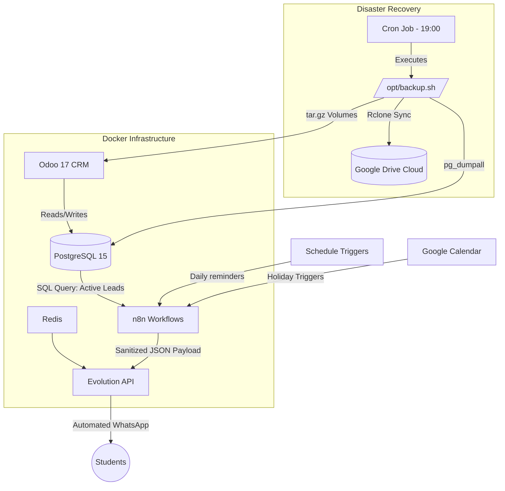

# 🚀 VM Autoescola - Automations & Infrastructure


Complete automation stack and infrastructure documentation for **VM Autoescola**, featuring **n8n** workflows, **Odoo 17 CRM** integration, **Evolution API** WhatsApp notifications, and automated daily **Docker** infrastructure backups to **Google Drive**.

---

## 🏗️ System Architecture



---

## 📅 Chronological Implementation History

### 1. Odoo 17 Integration & Active Leads Filtering
- **Objective:** Dynamically query the Odoo database to extract active students only, excluding those who have already completed the process (`Concluído / CNH Emitida`).
- **Implementation:** Custom SQL query utilizing subqueries and null handling in PostgreSQL to join the `crm_lead` and `crm_stage` tables.

### 2. WhatsApp Automations via Evolution API (n8n)
Nine scheduled n8n workflows query Odoo directly in PostgreSQL and send personalized WhatsApp messages through Evolution API. Every workflow uses a `Switch` node on the custom field `x_sexo` (`M` / `F`) to adapt the wording (o senhor / a senhora), sanitizes phone numbers (`replace(/\D/g, '')`) and greets the student by first name (`split(' ')[0]`).

| Workflow | Trigger | What it does |
|---|---|---|
| `practical_lesson_reminder.json` | Daily, 13:00 | Reminds students of a practical driving lesson scheduled for tomorrow (`x_inicio_aulas_praticas`) |
| `medical_exam_reminder.json` | Daily, 13:00 | Reminds students of tomorrow's medical exam (`x_exame_medico`) |
| `psych_exam_reminder.json` | Daily, 13:00 | Reminds students of tomorrow's psychological exam (`x_exame_psicotecnico`) |
| `theory_exam_reminder.json` | Daily, 13:00 | Reminds students of tomorrow's Detran theory exam (`x_exame_teorico`) |
| `driving_test_reminder.json` | Daily, 13:00 | Reminds students of tomorrow's Detran driving test (`x_exame_pratico`) |
| `unexcused_absences_alert.json` | Daily, 08:00 | Politely asks students flagged with 3 unexcused absences to cancel in advance |
| `welcome_new_student.json` | Daily, 08:00 | Welcomes students enrolled the previous day |
| `holiday_notifications.json` | Sun–Thu, 17:00 | Reads **Google Calendar** and, if tomorrow is a holiday, notifies all active students that the school will be closed |
| `cnh_congratulations.json` | Daily, 10:00 | Congratulates students moved to `Concluído / CNH Emitida` the previous day |

### 3. Backup & Security Infrastructure (Docker & Rclone)
- **Architecture:** Linux Docker server hosting **Odoo 17**, **n8n**, **Evolution API**, **Redis**, and **PostgreSQL**.
- **Daily Backup Strategy (19:00):**
  - Automated script (`/opt/backup.sh`) configured via `cron`.
  - Performs a complete PostgreSQL database dump (`pg_dumpall`).
  - Compresses Docker configuration directories and volumes.
  - Securely uploads the compressed package to a dedicated folder in **Google Drive** using **Rclone**.

---

## 🛠️ Tools & Technical Setup

### 1. n8n (Self-Hosted Workflow Automation)
- **Role:** Orchestrates webhook triggers, cron schedules, and data processing.
- **Configuration:**
  - Running in Docker via container `n8n`.
  - Authenticated via n8n REST API Keys for automated internal maintenance and reporting workflows.
  - Environment variables configured for timezone (`America/Fortaleza`) and secure webhook URLs.

### 2. Odoo 17 ERP & PostgreSQL 15
- **Role:** Core CRM and database backend (`vm-autoescola-db-1` & `vm-autoescola-web-1`).
- **Configuration:**
  - Custom PostgreSQL queries leveraging `crm_lead` and `crm_stage` tables to filter active leads (`Concluído / CNH Emitida` exclusion).
  - Automated daily database dumps via `pg_dumpall` inside the container lifecycle.

### 3. Evolution API & Redis (WhatsApp Gateway)
- **Role:** Multi-device WhatsApp instance manager and cache layer (`evolution-api` & `evolution-redis`) for automated outbound notifications.
- **Configuration:**
  - Containerized deployment communicating with n8n HTTP Request nodes.
  - Payload structure utilizing regex sanitization (`replace(/\D/g, '')`) for phone numbers and dynamic first-name extraction.

### 4. Rclone & Google Drive Backup Strategy
- **Role:** Cloud disaster recovery and automated storage synchronization.
- **Configuration:**
  - Configured via `rclone config` using OAuth2 port forwarding and the Google Drive remote (`gdrive:`).
  - Automated cron job executed daily at 19:00 (`0 19 * * * /bin/bash /opt/backup.sh`) combining database dumps and Docker directory archives (`/home/suporte/vm-autoescola`).

---

## 📂 Repository Structure

```text
vm-autoescola-automations/
├── scripts/
│   └── backup.sh                  # Automated PostgreSQL dump & Rclone cloud sync script
├── sql/
│   └── active_leads_filter.sql    # Odoo 17 PostgreSQL query for active students
├── workflows/
│   ├── practical_lesson_reminder.json  # Practical lesson reminder (day before)
│   ├── medical_exam_reminder.json      # Medical exam reminder (day before)
│   ├── psych_exam_reminder.json        # Psychological exam reminder (day before)
│   ├── theory_exam_reminder.json       # Detran theory exam reminder (day before)
│   ├── driving_test_reminder.json      # Detran driving test reminder (day before)
│   ├── unexcused_absences_alert.json   # Unexcused absences alert
│   ├── welcome_new_student.json        # Welcome message for new enrollments
│   ├── holiday_notifications.json      # Google Calendar holiday alerts
│   └── cnh_congratulations.json        # CNH (driver license) congratulations
└── README.md                      # Project documentation and architecture overview
```

---

## ⚙️ How to Use

1. **Workflows:** in n8n, go to *Workflows → Import from File* and select a `.json` from `workflows/`.
2. **Credentials:** link your own *Postgres* credential (Odoo database) and, for the holiday workflow, your *Google Calendar* credential and calendar.
3. **Evolution API:** replace `YOUR_EVOLUTION_API_KEY` in the HTTP Request nodes with your instance key (or use an n8n *Header Auth* credential), and adjust the instance name in the URL.
4. **Backup:** copy `scripts/backup.sh` to `/opt/backup.sh`, set up an rclone remote named `gdrive`, and add the cron line shown in the script header.

---

## 🔒 Security & Compliance
- **Data Sanitization:** All sensitive credentials, database passwords, API keys, and environment variables (`.env`) are strictly excluded from this repository.
- **Privacy & LGPD Compliance:** Student phone numbers and personal records are processed dynamically in-memory during workflow execution and are never exposed in public logs or version control.
